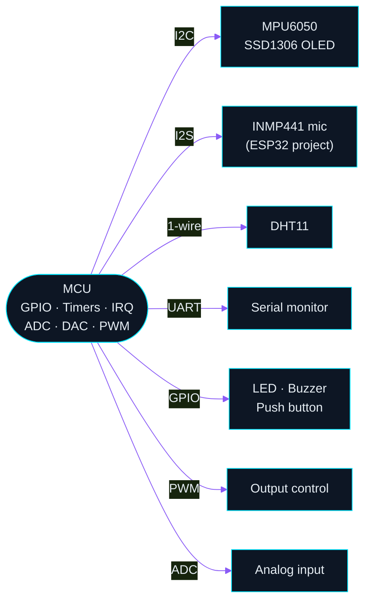
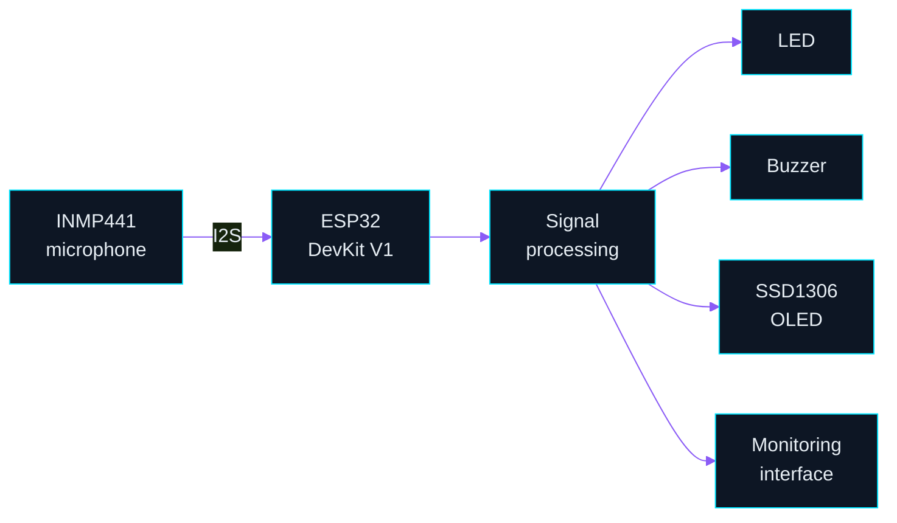
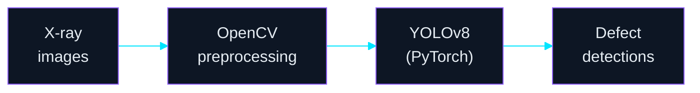
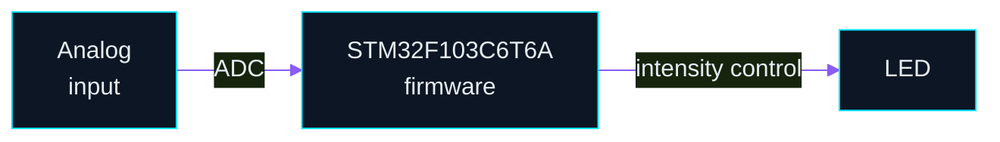
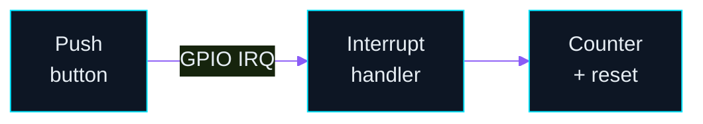
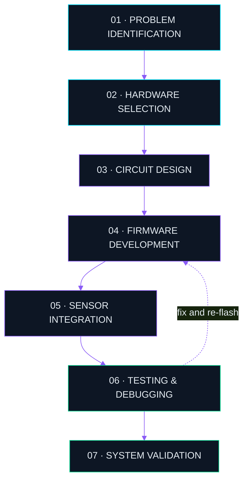

 

**Amala Allson N**
Electronics and Communication Engineering Student · Embedded Systems Developer · Hardware & Firmware Engineer

 

<!-- Add LinkedIn / email badges here once you want them public:

-->

Electronics and Communication Engineering student passionate about embedded systems, low-level firmware, hardware integration and intelligent electronic systems. My direction: **embedded systems, hardware–firmware development and semiconductor engineering.**

<table>
<tr>
<td><b>FOCUS</b></td>
<td>Bare-metal programming · Microcontroller architecture · Hardware–firmware integration · Sensor interfacing</td>
</tr>
<tr>
<td><b>DOMAINS</b></td>
<td>IoT & edge computing · Embedded AI · Digital electronics · Communication protocols · Real-time monitoring</td>
</tr>
<tr>
<td><b>PLATFORMS</b></td>
<td>STM32 · ESP32 · PSoC 4</td>
</tr>
</table>

## HARDWARE ECOSYSTEM // SYSTEM ARCHITECTURE

Generic interface map. Pin numbers and wiring are shown only where a project documents them, so none are shown here.

<b>Text-based view (mobile friendly)</b>

| Platform | Device | Role in my work |
|:--|:--|:--|
| **STM32 Blue Pill** | STM32F103C6T6A | Bare-metal / CubeIDE firmware |
| **ESP32 DevKit V1** | ESP32 | Sensor + signal-acquisition projects |
| **PSoC 4100S Plus** | Cortex-M0+ | Peripheral and interrupt exercises |
| **ESP32-CAM** | ESP32 + camera | Exploration, planned integration |

## FEATURED PROJECTS

> **Repository status.** The embedded projects below are not yet published as public repositories on this account, so none are linked. Each card is marked **REPO PENDING**. Links are added as projects are published.

### A · PneuSense — Intelligent Pneumatic System Monitoring

| | |
|:--|:--|
| **Problem** | Monitor a pneumatic system through acoustic signal acquisition and raise local alerts. |
| **Hardware** | ESP32 DevKit V1 · INMP441 microphone · SSD1306 OLED · LED · buzzer |
| **Stack** | Embedded firmware · signal acquisition · monitoring interface |
| **Wiring** | Pin map not yet documented publicly |
| **Repository** | Pending |
| **Demo** | Pending |

Functional signal flow. Not a wiring diagram.

### B · Secure QR Medicine Authentication

| | |
|:--|:--|
| **Problem** | Verify medicine authenticity by scanning a QR code or barcode and checking it against a database. |
| **Hardware** | Scanning input only where implemented (not documented publicly) |
| **Stack** | Python processing · MySQL · dashboard |
| **Contribution split** | Software and data-processing project; embedded hardware is not claimed |
| **Repository** | Pending |

### C · AXI Semiconductor X-ray Defect Inspection

| | |
|:--|:--|
| **Problem** | Detect defects in semiconductor X-ray inspection images. |
| **Stack** | Python · PyTorch · YOLOv8 · OpenCV |
| **AI / software** | Image preprocessing, model training and defect detection |
| **Embedded hardware** | None claimed. This is a computer-vision project. |
| **Repository** | Pending |

### D · STM32 Bare-Metal Development

| | |
|:--|:--|
| **Problem** | Learn the STM32 peripheral stack at register level and control outputs from analog input. |
| **Hardware** | STM32 Blue Pill (STM32F103C6T6A) · LED |
| **Stack** | Embedded C · STM32CubeIDE |
| **Topics** | GPIO · ADC · LED intensity control |
| **Wiring** | Pin map not yet documented publicly |
| **Repository** | Pending |

Functional flow. Not a wiring diagram.

### E · PSoC 4100S Plus Development

| | |
|:--|:--|
| **Problem** | Practice peripheral configuration and interrupt-driven input on a PSoC 4. |
| **Hardware** | PSoC 4100S Plus · push button |
| **Stack** | Embedded C · PSoC Creator 4.4 |
| **Topics** | GPIO · timers · PWM · ADC · UART · I2C · interrupt handling |
| **Application** | Push-button counter with reset |
| **Repository** | Pending |

## PUBLIC REPOSITORIES

Software and web work currently public on this account.

| Repository | Language | Note |
|:--|:--|:--|
| [Portfolio](https://github.com/amalaallson/Portfolio) | TypeScript | Web portfolio |
| [vitalsync](https://github.com/amalaallson/vitalsync) | TypeScript | Web application |
| [Monastery360](https://github.com/amalaallson/Monastery360) | n/a | Fork of [Bavithran100/Monastery360](https://github.com/Bavithran100/Monastery360) |
| [lmsapp](https://github.com/amalaallson/lmsapp) | n/a | Software project |
| [Allson](https://github.com/amalaallson/Allson) | n/a | Scratch repository |
| [allson77](https://github.com/amalaallson/allson77) | n/a | Scratch repository |

## TECHNICAL SKILLS

<table>
<tr>
<td width="160"><b>PROGRAMMING</b></td>
<td>

</td>
</tr>
<tr>
<td><b>MICROCONTROLLERS</b></td>
<td>

</td>
</tr>
<tr>
<td><b>HARDWARE</b></td>
<td>

</td>
</tr>
<tr>
<td><b>COMMUNICATION</b></td>
<td>

</td>
</tr>
<tr>
<td><b>TOOLS</b></td>
<td>

</td>
</tr>
<tr>
<td><b>AI & VISION</b></td>
<td>

</td>
</tr>
</table>

## HOW I BUILD SYSTEMS

## GITHUB TELEMETRY

<table>
<tr>
<td align="center"></td>
<td align="center"></td>
</tr>
<tr>
<td colspan="2" align="center"></td>
</tr>
</table>

## CURRENT FOCUS // ROADMAP

<!-- Change [ ] to [x] only when a topic is genuinely complete. -->

- [ ] Advanced Embedded C
- [ ] STM32 bare-metal development
- [ ] Hardware–firmware integration
- [ ] RTOS fundamentals
- [ ] Embedded Linux
- [ ] Semiconductor and VLSI fundamentals
- [ ] Embedded AI

**DESIGNING. CONNECTING. DEBUGGING. BUILDING.**

